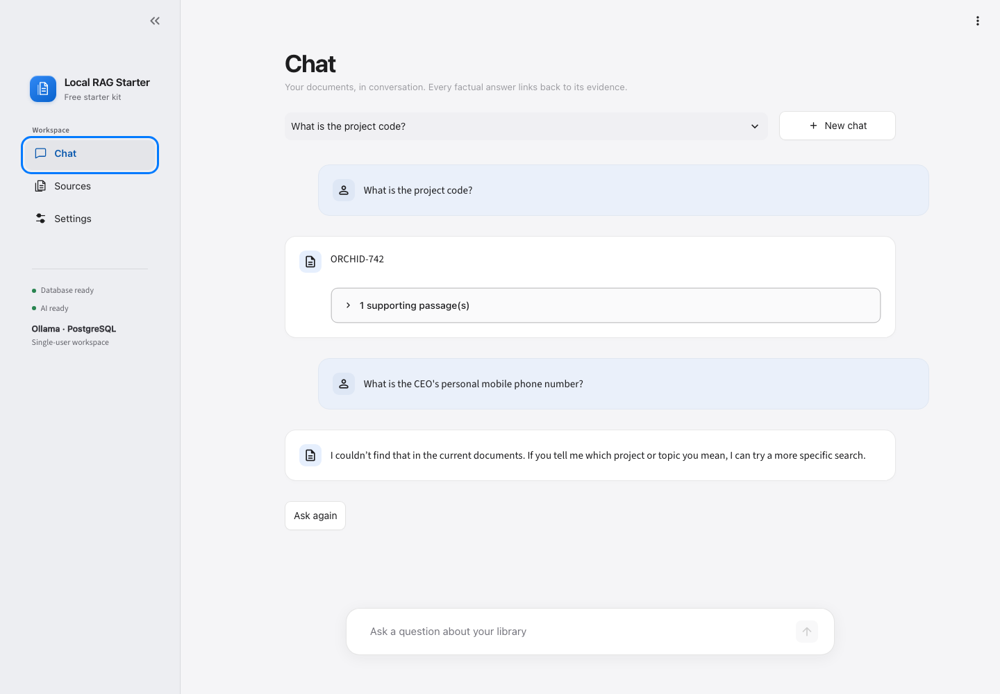

# Building a practical local RAG starter

## Problem

A document chatbot is easy to demonstrate and harder to make reliable. Common failures include stale passages after edits, partial replacements, invented citations, confusing setup, and an accidental dependency on paid services.

## Solution

Local RAG Starter turns a working private-library application into an MIT-licensed developer starter. Its default path uses uploads, Ollama, and local PostgreSQL/pgvector. Chat, Sources, and Settings keep everyday use focused; architecture and extension guidance live in documentation.

## Engineering decisions

- Immutable originals and transactional publication preserve the previous complete document when extraction, embedding, or database writes fail.
- Stable document IDs and content-hash versions make repeated uploads idempotent.
- Versioned index generations permit verified rebuilds and guarded recovery.
- Pipeline identity checks distinguish embedding models even when dimensions match.
- Citation and evidence-revision checks reject invented references and answers saved against changed evidence.
- Optional Drive and website connectors reconcile only their own sources and preserve complete snapshots on failure.
- Typed configuration, reproducible dependencies, isolated database tests, and a fictional evaluation corpus make the project reusable.

## Verification and presentation

See VALIDATION.md for the current measured results and open verification limits. Screenshots use only the fictional sample handbook. Model evaluation records readable answers as well as binary checks; it does not rely solely on the model grading itself.

## Boundaries

This is a local single-user starter. It does not claim public hosting, multi-user authentication, OCR, hybrid retrieval, reranking, arbitrary vector-store support, or live verification of paid providers. The source is prepared as a GitHub template; hosted deployment is outside this delivery.
