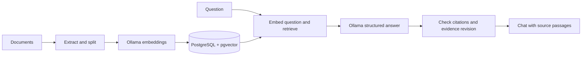

# Local RAG Starter

**Build a chatbot that answers from your documents, with sources you can inspect.**

A free, MIT-licensed Python starter kit using **Streamlit**, **Ollama**, and **PostgreSQL with pgvector**. Upload a document, ask a question, and open the passages behind the answer. Run the default workflow on your own computer without a paid AI API or cloud account.


[Beginner tutorial](TUTORIAL.md) · [Architecture](docs/ARCHITECTURE.md) · [Configuration](.env.example) · [Verification](VALIDATION.md)

## What you can build on

- **Document ingestion:** text PDFs, DOCX, UTF-8 TXT, Markdown, and CSV; explicit replacement and removal.
- **A complete RAG pipeline:** extraction, overlapping passages, local embeddings, exact cosine retrieval, structured generation, and citation checks.
- **A focused workspace:** Chat, Sources, and Settings, with separate saved conversations and follow-up questions.
- **Safe index updates:** failed replacements preserve the previous document; embedding/chunk changes build a separate index before activation.
- **Optional extensions:** a directly monitored Google Drive folder, bounded public HTTPS website imports, Supabase PostgreSQL, and explicitly selected paid model adapters. See [integration requirements and verification limits](docs/INTEGRATIONS.md).

The default models are `qwen3:4b` for answers and `nomic-embed-text:v1.5` for 768-dimensional embeddings. PostgreSQL is the only implemented vector store. Search targets small document libraries.

## New to Python or local AI?

Start with the **[complete beginner tutorial](TUTORIAL.md)**. It covers installing prerequisites, every terminal, expected results, troubleshooting, backups, and your first cited answer. A downloadable, generated reading copy is [START-HERE.html](START-HERE.html): save it and open it in a browser; its demo image is embedded.

RAG means *retrieval-augmented generation*: find relevant document passages first, then ask the model to answer using those passages. It does not train or fine-tune the model.

## Quick start

Install **Git**, **Python 3.12**, **Docker with Compose**, and **Ollama** first. The [tutorial](TUTORIAL.md#1-install-the-prerequisites) includes installation links and a managed Python option. Allow several GB of disk space for models and images; speed and memory requirements depend on your hardware.

### 1. Clone and create a Python environment

**macOS / Linux:**

```bash
git clone https://github.com/matcalabs002-sketch/local-rag-starter.git
cd local-rag-starter
python3.12 -m venv .venv
source .venv/bin/activate
```

**Windows PowerShell:**

```powershell
git clone https://github.com/matcalabs002-sketch/local-rag-starter.git
cd local-rag-starter
py -3.12 -m venv .venv
.\.venv\Scripts\Activate.ps1
```

If you installed Python using uv, use `uv venv --python 3.12 --seed .venv` instead of the `venv` creation command, then activate as above.

### 2. Install, configure, and start the database

**Both platforms, in the activated application terminal:**

```text
python -m pip install -r requirements.txt
python -m rag setup
docker compose up -d --wait
```

`setup` creates a private `.env` with a generated database password. **Do not copy `.env.example` first** when using this setup command. An existing `.env` is preserved. Docker must be running; PostgreSQL binds to `127.0.0.1:55432` and persists in a Docker volume.

### 3. Start Ollama in a second terminal

**macOS / Linux — model server terminal:**

```bash
OLLAMA_HOST=127.0.0.1:11435 ollama serve
```

**Windows PowerShell — model server terminal:**

```powershell
$env:OLLAMA_HOST = "127.0.0.1:11435"
ollama serve
```

Leave that terminal open. In the **application terminal**, download both models:

**macOS / Linux:**

```bash
OLLAMA_HOST=127.0.0.1:11435 ollama pull qwen3:4b
OLLAMA_HOST=127.0.0.1:11435 ollama pull nomic-embed-text:v1.5
```

**Windows PowerShell:**

```powershell
$env:OLLAMA_HOST = "127.0.0.1:11435"
ollama pull qwen3:4b
ollama pull nomic-embed-text:v1.5
```

Already running Ollama on `11434`? Keep that server and set `OLLAMA_URL=http://127.0.0.1:11434` in `.env` instead. Pull both models through that server; skip the second server above.

### 4. Initialize and launch

**Both platforms, in the application terminal:**

```text
python -m rag init
python -m rag check
python -m streamlit run app.py
```

`check` should report four `OK` lines. Open [http://127.0.0.1:8503](http://127.0.0.1:8503).

In **Sources**, upload `samples/welcome-handbook.txt` and select **Index documents**. In **Chat**, ask **What is the project code?** Expect **ORCHID-742** with a supporting passage. Ask for the CEO's personal phone number to check a missing-information response.

Stop Streamlit and a manually started Ollama with **Ctrl+C** in their terminals. `docker compose stop` preserves database data; `docker compose start` restarts it. See the [restart checklist](TUTORIAL.md#8-stop-and-start-again).

## How it fits together



Read the [architecture guide](docs/ARCHITECTURE.md) for ingestion and chat sequences, database relationships, storage locations, failure behavior, and extension points.

## Configuration and development

Environment variables override `.env`; absent values use code defaults. [.env.example](.env.example) documents every supported setting and is never loaded as runtime configuration. Restart Streamlit or reload after editing `.env`.

- Keep originals in private `RAG_DATA_DIR` storage and back it up **together with the database**. Moving this setting does not migrate files.
- Save answer-model changes in Settings. For embedding or chunk changes, use **Settings → Advanced → Rebuild index**.
- Base installation uses the shared lock as constraints and installs runtime dependencies only. Drive packages and developer/documentation tools are explicit extras.
- For native PostgreSQL instead of Docker, see the [database alternative](TUTORIAL.md#10-use-an-existing-postgresql-server).

Install development tools and run checks:

```text
python -m pip install -r requirements-dev.txt
ruff check .
python -m pytest tests -m "not integration"
python -m pip check
```

For the full database suite and real-model evaluation, follow [Contributing](CONTRIBUTING.md). These require a **disposable loopback database ending in `_test`**; they erase test-library data. CI covers database tests, Windows/macOS unit tests, dependency auditing, guide reproducibility, and secret scanning. [VALIDATION.md](VALIDATION.md) distinguishes measured results from remaining checks.

## Documentation map

| Guide | What it covers |
| --- | --- |
| [Beginner tutorial](TUTORIAL.md) | Install, first answer, document changes, troubleshooting, backup and restart |
| [Architecture](docs/ARCHITECTURE.md) | Components, data flow, database relationships, safeguards, extension points |
| [Integrations](docs/INTEGRATIONS.md) | Optional Drive, websites, remote PostgreSQL, and paid providers |
| [Contributing](CONTRIBUTING.md) | Development setup, isolated tests, real-model evaluation, documentation builds |
| [Validation](VALIDATION.md) | Actual verification evidence and its limits |
| [Security](SECURITY.md) | Local-use boundary and safe reporting |
| [Portfolio case study](PORTFOLIO-CASE-STUDY.md) | Engineering decisions and demonstrated outcomes |

## Boundaries and cost

This is a **local, single-user application** bound to loopback, with no authentication or public widget. Do not expose it directly to the internet. OCR, encrypted PDFs, image understanding, recursive Drive sync, authenticated crawling, hybrid retrieval, and reranking are not included.

Citation checks establish that cited passages were supplied to the model; they do **not** prove every claim follows from those passages. Inspect evidence for important answers. Prompts mitigate instruction injection without guaranteeing complete resistance.

Local inference requires your computer, electricity, disk space, and internet downloads. Check [Docker Desktop's license terms](https://docs.docker.com/subscription-billing/desktop-license/) for your organization; Linux Docker Engine with Compose is an alternative. Optional OpenAI and Anthropic adapters can incur charges, have mock-tested contracts, and have no automatic paid fallback or enforced spending cap.

## Use it for your own project

Choose **Use this template** on GitHub to create your own repository, or clone this one to explore. Customize the app and prompts for your use case, preserve the [MIT license](LICENSE), and verify your own models and documents before advertising new capabilities. Contributions are welcome through [issues](https://github.com/matcalabs002-sketch/local-rag-starter/issues) and pull requests.
