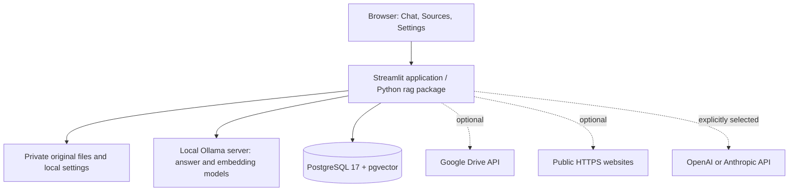
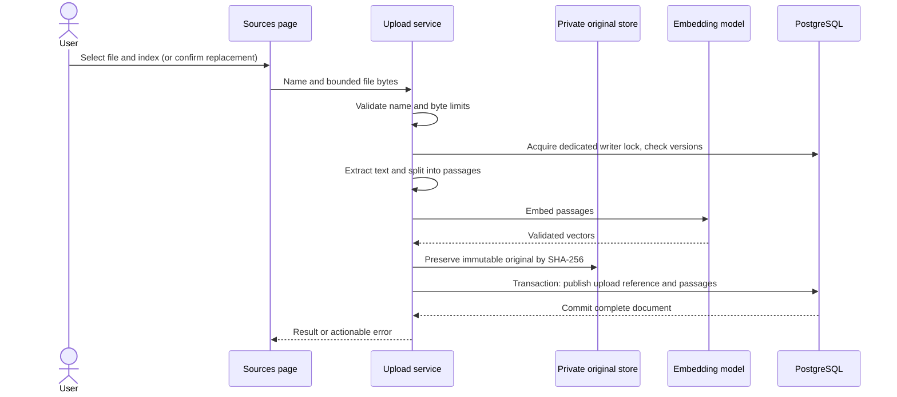
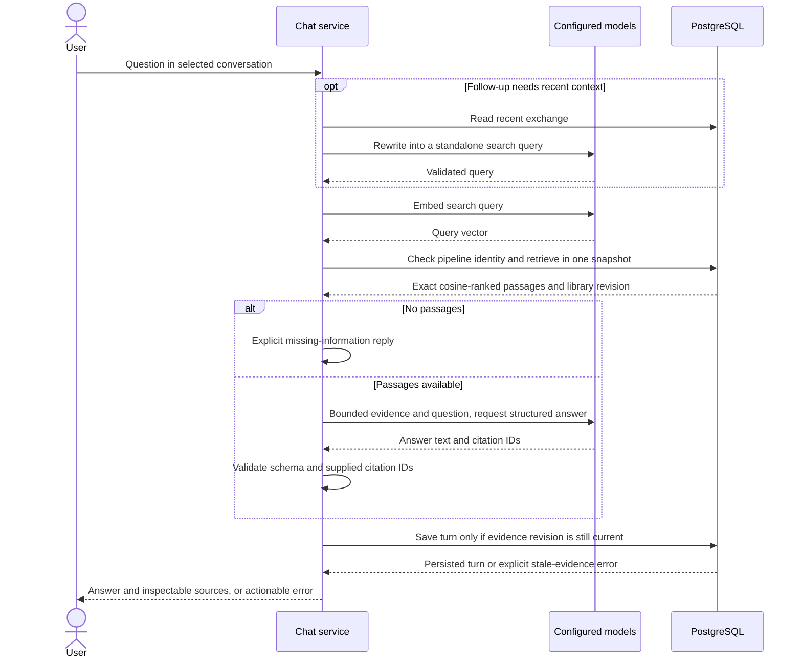
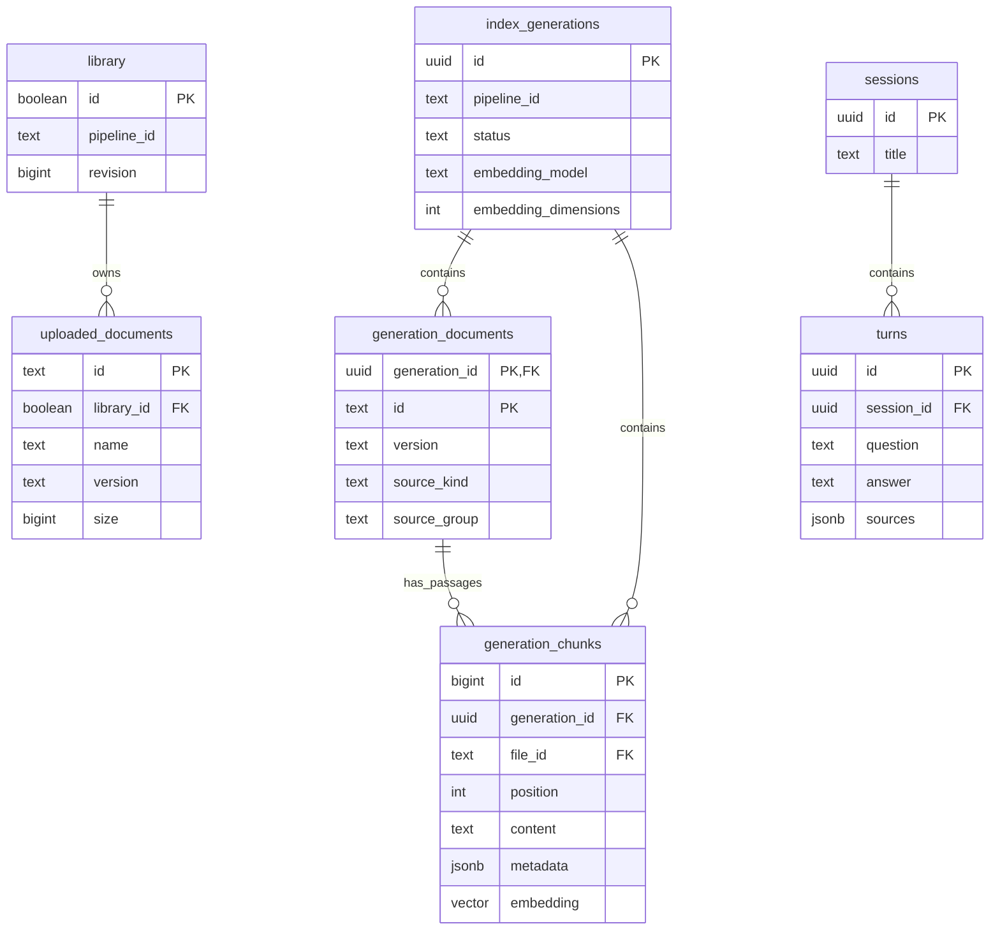

# Local RAG Starter architecture

## The idea in plain language

**Retrieval-augmented generation (RAG)** gives a language model relevant reference material before asking it to answer. Here, a document becomes overlapping text passages. An embedding model represents each passage as a numeric vector. When you ask a question, the same model embeds the question and PostgreSQL finds nearby passage vectors. The answer model receives a bounded selection of those passages, then the app checks its cited passage numbers and saves the conversation.

The system does not fine-tune a model. Originals let you rebuild the index; embeddings make retrieval possible; retrieved passage text gives the answer model evidence. These are different responsibilities.

## Components and service boundaries

| Component | Default location | Responsibility |
| --- | --- | --- |
| Browser and Streamlit | `127.0.0.1:8503` | Workspace and progress/errors; no separate React frontend or HTTP API layer |
| Ollama | `127.0.0.1:11435` | `qwen3:4b` answers; `nomic-embed-text:v1.5` embeddings |
| PostgreSQL/pgvector | `127.0.0.1:55432` via Compose | Searchable passages/vectors, source registry, index generations, conversations, activity |
| Original file storage | `RAG_DATA_DIR`, default `.private` | Content-addressed immutable upload originals and private workspace settings |
| Configuration | Private `.env` plus environment | Connections, model choices, limits, private storage path |

With the default providers, document extraction, embedding, retrieval, and generation run on your computer. Installation downloads software/models. Optional connectors send requests to their configured services; selecting a cloud model sends its request data to that provider. Supabase moves PostgreSQL storage to the configured remote host. There is no implicit paid fallback.

`.env.example` is documentation, never runtime configuration. Environment variables override `.env`; absent keys use typed code defaults. The UI persists selected settings privately; restart/reload and active-index checks ensure configuration must match the searchable embedding pipeline.

## Document ingestion

Text extraction uses pypdf, docx2txt, UTF-8 decoding, and CSV handling. Preview and indexing use the same recursive splitter. Defaults are 1,000-character passages with 150-character overlap, 50 MiB per upload, and additional bounded text/passage counts.

Filenames are labels, never trusted filesystem paths. A generated document ID identifies an upload; SHA-256 of its bytes identifies its version and original blob. Identical content is unchanged; a changed upload with the same name requires explicit replacement. Embedding or publication failure keeps the previous complete searchable document. An unreferenced blob from a failed operation can be removed through explicit cleanup.

Google Drive follows the source-adapter contract, while websites use a bounded crawl and scoped reconciliation. Neither connector can delete local uploads. See [Integrations](INTEGRATIONS.md) for their actual limits.

## Question answering

The default retrieval limit is five passages with a 12,000-character evidence budget. Retrieval is exact cosine search, intended for small libraries; it does not use approximate indexes, hybrid search, or a reranker. Basic greetings have direct conversational replies and bypass factual retrieval.

A question embedding and document embeddings must share the same provider, model, dimensions, and chunk configuration. Equal dimensions alone do not make two models compatible. Pipeline identity is checked inside the retrieval snapshot. If evidence changes while the model is answering, saving fails explicitly rather than presenting a stale answer as current.

Structured output is validated using Pydantic contracts. Unknown citation numbers are rejected; an answer with no citations becomes the missing-information response. **Citation identity is not factual entailment**: a valid citation does not prove every generated claim follows from it. Source instructions are treated as untrusted, with measured but incomplete prompt-injection mitigation.

## Data model

All application tables live in the `python_rag` schema. The central relationships below are actual foreign keys; the diagram omits operational columns for readability.

`uploaded_documents` is the current local-upload registry. Its IDs and versions correspond logically to local entries in `generation_documents`; that correspondence is enforced by application publication/rebuild checks, not a direct foreign key between these two tables. Each generation can also contain Drive and website documents. Passage lookup uses the composite generation/document identity.

Additional tables record remote website configuration, exclusions, sync status, and activity. Legacy `documents`/`chunks` tables remain for migration compatibility; generation tables are the active search path. `schema.sql` is the source of truth. Deleting a document removes searchable copies across retained generations; old saved conversation text is separate from current evidence.

## Atomic updates and recovery

Only one index generation is active. A rebuild stages uploaded originals and all configured remote sources into a separate generation, then rechecks complete membership and versions before activation. Failed builds leave the previous active index available. Recovery to a previous generation is allowed only when its source versions match the current library; it cannot resurrect removed uploads.

Ordinary database operations use a connection pool. Writers acquire the same advisory lock using a dedicated physical session. A lost lock connection is never silently reconnected. Upload references and passages publish transactionally. Remote source reconciliation is scoped to its source kind/group and only proceeds after a complete snapshot.

| Failure | Visible behavior and recovery |
| --- | --- |
| Unreadable upload or embedding failure | Explicit source/activity error; previous replacement remains searchable |
| Incomplete remote snapshot | No destructive reconciliation; retry after fixing connectivity |
| Changed evidence during answer | Answer is not saved; retry against current evidence |
| Failed index rebuild | Existing active generation remains; fix error before retrying |
| Embedding configuration mismatch | Retrieval is rejected; restore matching settings or rebuild |
| Lost writer connection | Operation fails; do not reconnect and continue without its lock |
| Missing original file | Rebuild fails visibly; restore matching private storage from backup |
| Unreferenced original | Explicit cleanup removes it; referenced retained-generation blobs stay |

Remote refresh runs while the application is open. `python -m rag sync` is the explicit non-UI alternative, not a separately provisioned background worker. Drive sign-in failure does not block independently configured website refresh.

## Code map and extension points

| Module | Responsibility |
| --- | --- |
| `app.py`, `rag/workspace/` | Streamlit entry point, Chat/Sources/Settings presentation |
| `rag/config.py`, `rag/__main__.py` | Typed settings and setup/init/check/sync/cleanup commands |
| `rag/uploads.py`, `rag/loaders.py` | Immutable originals, extraction, shared splitting, upload publication |
| `rag/sources.py`, `rag/drive.py` | Source protocol and Drive adapter |
| `rag/models.py`, `rag/types.py` | Provider capabilities, requests, structured model/data contracts |
| `rag/chat.py` | Follow-up handling, retrieval, answer validation, persistence orchestration |
| `rag/store.py`, `rag/schema.sql` | Database operations, locks, transactions, generations, source registry |
| `rag/sync.py`, `rag/websites.py`, `rag/reindex.py` | Source refresh, bounded crawl, complete index rebuild/recovery |

**New source:** implement `snapshot`, `download`, and `verify` with stable IDs, string versions, bounded reads, and complete snapshots. Include it in rebuild sources and source-scoped reconciliation. Test incomplete snapshots and version changes before enabling deletion.

**New model:** add a declared capability and adapter request/response validation. Verify dimensions, structured output, missing facts, citation identity, and the fictional real-model evaluation. Do not advertise live provider support based only on mocked tests.

**New storage:** PostgreSQL is the sole backend. Add an interface when a second implementation is working and verified; the starter intentionally avoids unused abstraction layers.

**Changed prompt or retrieval:** retain source boundaries and citation validation, run the binary evaluation, and inspect recorded answers. Do not rely on model self-evaluation alone.

## Operational boundary

This is a private, single-user tool with no public authentication, tenant separation, or hosted spending enforcement. Back up PostgreSQL and private original/settings storage together, with writers stopped for a consistent copy. Physical device checks and optional live integrations have separate verification limits in [Validation](../VALIDATION.md).
